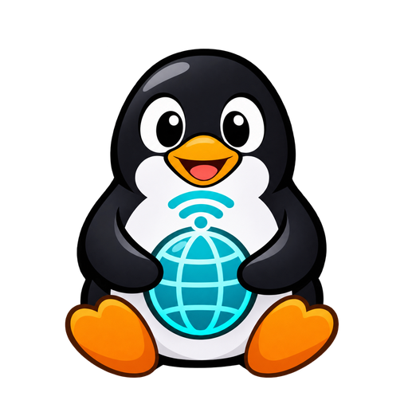

# LinUwU Launcher

<div align="center">



### The last launcher you will need.

[](COPYING)
[](https://wayland.freedesktop.org/)
[](https://www.typescriptlang.org/)
[](https://www.electronjs.org/)
[](https://vitejs.dev/)

</div>

---

LinUwU Launcher is a high-performance gaming frontend for Linux, macOS, and Windows. It combines Epic Games (Legendary), GOG (gogdl), Amazon Games (Nile), Xbox Gaming, Sideloading, OnlineFix multiplayer bridging, and an integrated SteamRIP storefront into one unified platform accelerated by native Wayland support.

---

## Universal 1-Line Installer

Install LinUwU on any Linux distribution (Arch Linux, Debian, Ubuntu, Fedora, openSUSE, Pop!_OS, Nobara, CachyOS, Void, etc.) with a single command:

```bash
curl -fsSL https://raw.githubusercontent.com/Nirusaki-Malaal/LinUwU-Launcher/main/install.sh | bash
```

### Installer Highlights
- **Zero Configuration**: Automatically detects your distribution and desktop environment.
- **Native Wayland Auto-Wrapper**: Automatically configures the `linuwu` binary wrapper with `--ozone-platform=wayland` when running under Wayland compositors (GNOME, KDE Plasma, Hyprland, Sway, Niri, River).
- **Desktop Integration**: Installs `.desktop` menu shortcut and high-resolution icons to system application directories and icon caches.
- **User or System Mode**: Supports non-root installation with the `--user` flag (`bash install.sh --user`) or full system installation (`/opt/LinUwU`).
- **Clean Uninstaller**: Easily remove anytime using `bash install.sh --uninstall`.

---

## Exclusive Fork Features

### 1. SteamRIP Integrated Storefront
- Directly browse, search, and explore titles from community catalogs (`https://hydralinks.cloud/sources/steamrip.json`).
- High-resolution banners, game summaries, download links, and direct extraction and installation.
- Automatically sideloads into your local library with launch options and Wine runners pre-configured.

### 2. OnlineFix Native Linux Multiplayer Support
- Built-in bridge and bypasses for OnlineFix-enabled games on Linux.
- Seamless multiplayer Steamworks injection: automatically handles SpaceWar and custom AppID emulation, fake Steam client tunnels, and native overlay compatibility.
- Play co-op and online multiplayer games through Wine and Proton with friends without manual tinkering.

### 3. Xbox Native Library & Sideloading
- Native integration for Xbox game management, saves, and runners.
- Built-in support for Xbox assets, custom wine runner discovery, cloud saves compatibility, and execution profiles.

### 4. Native Wayland First-Class Performance
- Eliminates XWayland latency and blurriness on mixed-DPI monitors.
- Full Wayland compositor integration with hardware-accelerated Ozone platform rendering.
- Native fractional scaling, window decor, and drag-and-drop support.

### 5. All Games Auto-Healing Unified Library
- Solved the store filter isolation bug where unselected stores or isolated Xbox games would hide the rest of the library.
- Self-healing filter state automatically displays all your games across Epic Games, GOG, Amazon, Sideloaded titles, SteamRIP, and Xbox in a single unified view.
- Automatic installation status resolution for non-store executables.

### 6. Cute LinUwU Penguin Mascot
- Custom Tux mascot with an internet antenna symbol, celebrating gaming freedom and connectivity.

---

## Core Features

- **Epic Games, GOG, and Amazon Games**: Full login, cloud save syncing, and library management via Legendary, gogdl, and Nile.
- **Wine / Proton / UMU / CachyOS**: Download and switch between custom Wine-GE, Proton-GE, and system compatibility layers with one click.
- **ProtonDB & AntiCheat Status**: Native ratings and anticheat verification before running games.
- **Custom Launch Options**: Environment variables, gamemode, mangohud, gamescope, and custom wrappers.
- **Offline Mode**: Play your installed games anytime, anywhere.
- **Sideload Any Game**: Easily add external Windows executables or native Linux binaries to your library.

---

## Building From Source

### Prerequisites
- Node.js (>= 20)
- npm or pnpm
- Git

```bash
# Clone the repository
git clone https://github.com/Nirusaki-Malaal/LinUwU-Launcher.git
cd LinUwU-Launcher

# Install dependencies
npm install

# Run type check
npm run codecheck

# Start development server
npm start

# Build production bundle
npm run build

# Package unpacked Linux build
./node_modules/.bin/electron-builder --linux --dir
```

---

## Credits & Upstream Projects

LinUwU is built on the shoulders of open-source projects:

- [Heroic Games Launcher](https://github.com/Heroic-Games-Launcher/HeroicGamesLauncher) - The base platform
- [Legendary](https://github.com/derrod/legendary) - Epic Games CLI client
- [gogdl](https://github.com/Heroic-Games-Launcher/heroic-gogdl) - GOG downloader
- [Nile](https://github.com/imLinguin/nile) - Amazon Games client
- [Comet](https://github.com/imLinguin/comet) - GOG Galaxy communication implementation
- [GE-Proton](https://github.com/GloriousEggroll/proton-ge-custom) - Custom Proton compatibility layer
- [umu-launcher](https://github.com/Open-Wine-Components/umu-launcher) - Unified Linux Wine launcher
- [DXVK](https://github.com/doitsujin/dxvk) & [VKD3D-Proton](https://github.com/HansKristian-Work/vkd3d-proton) - Direct3D to Vulkan translation

---

<div align="center">

**LinUwU Launcher — The last launcher you will need.**

</div>
